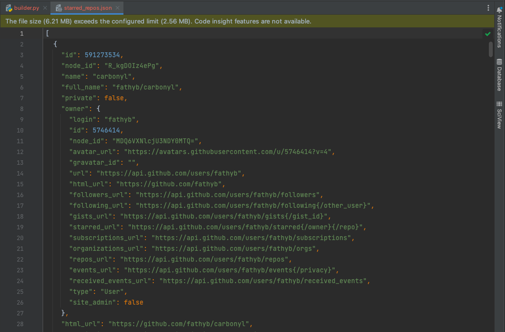
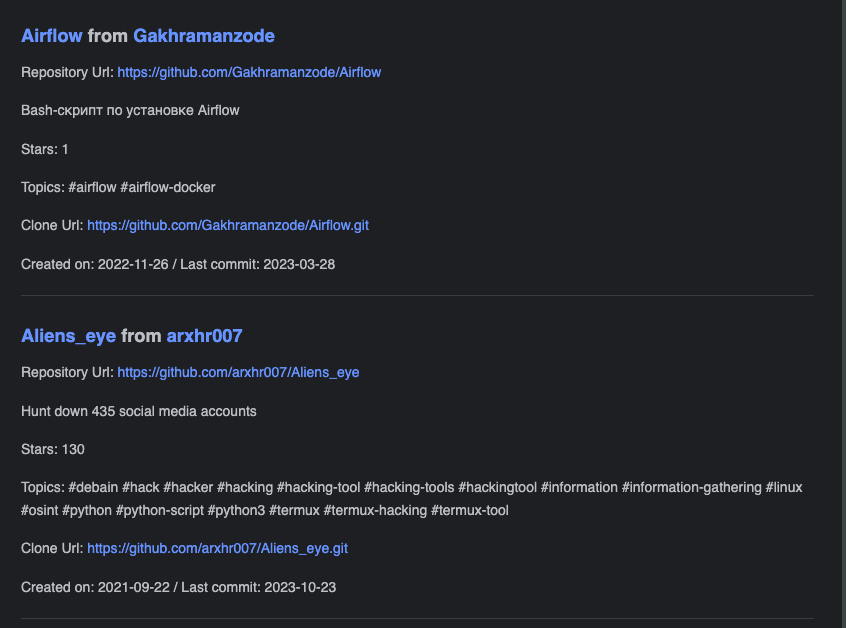

# OSINT Repos Intelligence Dataset

A repository-metadata collection and Python generator for OSINT, data collection, cybersecurity, automation, DevOps, and related development tools.

The collection is built from GitHub starred repositories and their owners. Metadata supports discovery and comparison; inclusion or a star does not establish that a tool is safe, maintained, or suitable for a particular investigation.

## Public sample and full collection

| Resource | What it contains |
| --- | --- |
| [Public sample](starred_repos_random.md) | 100 sampled repositories, with owners, descriptions, topics, stars, and update information; generated 14 November 2026 |
| Full snapshot, 14 November 2026 | 4,484 repositories; the release reports 15 additions since the previous update |
| Python generator | Code for building your own collection from GitHub stars |

**The 4,484 figure describes the full snapshot, not the 100-record public sample.** Counts are dated snapshot values, not a live total.

[Full release and available downloads](https://osintech.substack.com/p/osint-repos-intelligence-dataset-62b) · [Publication and subscription details](https://osintech.substack.com/about)

The referenced full release includes a PDF for paid subscribers. Available files, formats, and current access terms are stated on Substack; generator output formats below do not imply that every paid release includes every format.

## What the generator does

`builder.py` collects GitHub starred-repository information and generates reusable research references:

- JSON metadata;
- Markdown repository and contributor descriptions;
- PDF archive;
- topic lists;
- start.me bookmark HTML.

Repository names and owners, descriptions, topics, popularity indicators, and update timestamps help organize a changing technical collection.



## Quick start

Clone this repository and configure a GitHub API token in the `GITHUB_API_TOKEN` environment variable. Keep the token outside tracked files. See [GitHub token documentation](https://docs.github.com/en/authentication/keeping-your-account-and-data-secure/creating-a-personal-access-token).

Run the generator from the repository directory:

```bash
python3 builder.py
```

Full generation runs JSON → Topics → Markdown → PDF → start.me HTML. This project works with GitHub, not GitLab or Bitbucket. Large collections can take time to process.

## Output modes

```bash
# Full generation (default)
python3 builder.py -m full

# Refresh JSON metadata
python3 builder.py -m json

# Generate Markdown from existing JSON files
python3 builder.py -m markdown

# Generate PDF from existing JSON files
python3 builder.py -m pdf

# Generate topics
python3 builder.py -m topics

# Generate start.me bookmarks
python3 builder.py -m startme
```

## Compare snapshots

If `starred_repos.json` already exists, full mode automatically enables the new-version workflow:

1. Copy the current JSON to `starred_repos_previous.json` before refreshing.
2. Compare the current and previous snapshots.
3. Include a newly added repositories section in the PDF, followed by the full repository and contributor sections.

You can explicitly request this workflow:

```bash
python3 builder.py -m full --new-version
```

The flag also works with `-m json` and `-m pdf`. Markdown generation remains unchanged. Preserve the relevant snapshot files when comparing releases.

## Explore the results

Open the [public sample](starred_repos_random.md) and use your browser’s Find function to search names, descriptions, or topics. The generated collection can also be searched as Markdown or processed as JSON. Image badges were removed from generated Markdown to keep large documents manageable.



## Related projects

- [github-starred-repos-loader](https://github.com/bormaxi8080/github-starred-repos-loader): pull starred repositories locally.
- [git-repos-updater](https://github.com/bormaxi8080/git-repos-updater): update collected local repositories.
- [OSINTech’s Timeline](https://github.com/bormaxi8080/osint-timeline): weekly OSINT tools, resources, and investigations.

## Intended use

Tools and techniques are documented for informational, educational, and information security purposes. Users are responsible for complying with applicable laws and ethical standards. Evaluate third-party repositories before using them; metadata and popularity are research signals, not quality guarantees.

## Support and contact

[OSINTech on Substack](https://substack.com/@osintech) · [LinkedIn](https://www.linkedin.com/in/osintech/) · [Support OSINTech](https://www.buymeacoffee.com/osintech)
